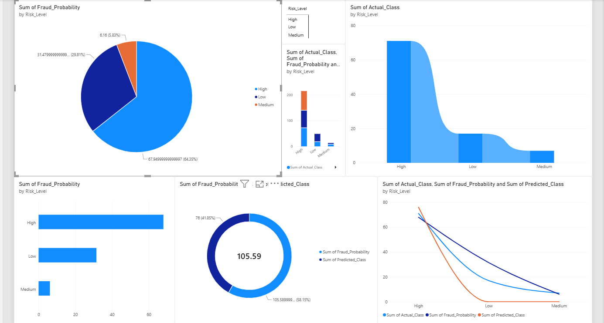

# 🔐 AI-Powered Financial Fraud Detection System

An end-to-end Machine Learning and Business Intelligence project designed to identify potentially fraudulent financial transactions using Python, Scikit-learn, PostgreSQL, Streamlit, and Power BI.

## 📌 Project Overview

This project analyzes financial transactions, identifies suspicious activities, and classifies transactions based on fraud probability.

It combines machine learning, data engineering, database integration, and interactive dashboards to support financial fraud monitoring.

## 🎯 Project Objectives

- Analyze financial transaction data.
- Clean and preprocess the dataset.
- Handle highly imbalanced data.
- Train and evaluate machine learning models.
- Tune the classification threshold.
- Store transaction predictions in PostgreSQL.
- Visualize fraud analytics using Streamlit and Power BI.

## 🛠️ Technologies Used

| Technology | Purpose |
|---|---|
| Python | Programming |
| Pandas, NumPy | Data processing |
| Matplotlib, Seaborn | Data visualization |
| Scikit-learn | Machine Learning |
| Streamlit | Interactive application |
| PostgreSQL | Database management |
| SQLAlchemy | Database integration |
| Power BI | Business Intelligence |
| Git & GitHub | Version control |

## 📂 Project Structure

```text
Financial_fraud_detection_system/
│
├── data/
├── models/
├── notebooks/
├── outputs/
├── src/
│   ├── data_ingestion.py
│   ├── data_validation.py
│   ├── data_cleaning.py
│   ├── preprocessing.py
│   ├── model_training.py
│   ├── threshold_tuning.py
│   ├── prediction_export.py
│   └── database_upload.py
│
├── powerbi/
│   ├── Financial_Fraud_Dashboard.pbix
│   └── fraud_dashboard.png
│
├── app.py
├── requirements.txt
├── .gitignore
└── README.md
```
## 📊 Power BI Dashboard Preview



## 📊 Dataset Information

Dataset: Credit Card Fraud Detection

Source: Kaggle

- Original transactions: 284,807
- Original features: 30
- Fraud cases: 492
- Genuine cases: 284,315

The dataset contains anonymized PCA-transformed features, transaction time, amount, and a fraud classification label.

## 🤖 Machine Learning Models

Two machine learning algorithms were implemented:

1. Logistic Regression
2. Random Forest Classifier

### Model Evaluation

| Metric | Logistic Regression | Random Forest |
|---|---:|---:|
| Precision | 5.62% | 94.52% |
| Recall | 87.37% | 72.63% |
| F1 Score | 10.57% | 82.14% |
| ROC-AUC | 96.58% | 93.91% |
| Average Precision | 67.19% | 80.12% |

### Threshold Optimization

The Random Forest model was further optimized using a classification threshold of 0.37.

Final test results:

- Precision: 93.42%
- Recall: 74.74%
- F1 Score: 82.97%
- True Positives: 71
- False Positives: 5
- False Negatives: 24
- True Negatives: 56,646

## 🗄️ Database Integration

PostgreSQL was integrated to store transaction-level predictions.

Database: fraud_detection_db

Table: transaction_predictions

Total prediction records: 56,746

## 📈 Dashboard

The project includes an interactive Streamlit application and Power BI dashboard for exploring fraud predictions and transaction risk levels.

## 🚀 Future Enhancements

- Support for multiple compatible transaction datasets.
- Real-time fraud detection.
- Improved model explainability.
- Advanced Power BI analytics.
- Model monitoring and retraining.

## 👨‍💻 Author

Abishake M

B.E. Computer Science and Engineering

## 📜 Disclaimer

This project is developed for educational and portfolio purposes using a publicly available anonymized credit card transaction dataset. Model predictions are experimental and should not be used directly for real financial decisions.
